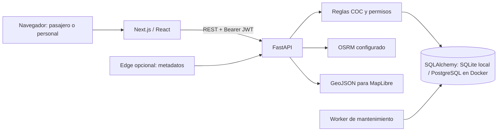

# Arquitectura y decisiones

## Componentes

El JWT permanece en memoria del navegador. Recargar la web exige iniciar sesión.
La interfaz no utiliza localStorage ni parámetros de URL para conservar tokens.
Las credenciales del proxy del tótem permanecen privadas en el servidor Next.js.
El navegador llama a `/api/kiosk/*`, sin recibir `X-Node-Key`.

## Organización

| Ruta | Responsabilidad |
| --- | --- |
| `BoardSafe-backend/app/api/` | Autenticación, recursos y validación de roles |
| `app/domain/` | Reglas de oferta, abordaje, restricciones y geografía |
| `app/services.py` | Recursos, auditoría y eventos dentro de la transacción |
| `app/integrations/` | OSRM y meteorología opcional |
| `app/demo.py` | Datos DEMO explícitos y restringidos al entorno local |
| `migrations/` | Evolución relacional y rama PostGIS |
| `boardsafe-frontend/src/lib/` | Cliente HTTP y fechas |
| `src/context/` | Sesión en memoria |
| `src/features/assistance/` | Pasajero, despacho, rutas y conductor |
| `src/features/resilience/` | Reportes, revisión, dibujo y gestión de cierres |
| `compose.deploy.yaml` y `deploy/` | PostgreSQL/PostGIS, migraciones, app y gateway |
| `src/hooks/` | Polling, acciones y WebSocket con recuperación por cursor |
| `src/features/risk/` | Zonas, clima y recursos |
| `src/features/monitoring/` | Continuidad y auditoría por rol |
| `src/features/edge/` | Provisionamiento de nodos |
| `src/features/kiosk/` y `src/lib/server/` | Tótem público y proxy de credenciales privadas |
| `src/components/` | Mapa, operaciones y administración |

Los componentes de negocio se separan de `page.tsx`. El cliente HTTP centraliza
errores y no decide si una operación es segura. Las respuestas que omiten campos
privados por rol se representan con campos opcionales en TypeScript.

## Estados y reglas

El recorrido habitual de asistencia es `requested → offered → accepted → onboard
→ completed`. Existen cancelación, caducidad, espera segura e interrupción.

Una ruta calculada se guarda como candidata. Una verificación humana registra
evidencia, autor y vigencia; los cierres confirmados pueden revocarla y cambiar
el estado de los viajes afectados. Se permite renovar una verificación vencida
tras comprobar otra vez las restricciones.

En un viaje ya abordado, la recuperación actual conserva la misma unidad y exige
una ruta verificada hacia el destino. Un transbordo necesita otro procedimiento.
Los errores 409 son resultados de reglas de negocio y muestran motivos, no se
ocultan ni se convierten en operaciones exitosas desde el frontend.

PostgreSQL usa un advisory lock para serializar determinadas decisiones críticas.
SQLite es para desarrollo local y no demuestra equivalencia en concurrencia.
El recorrido funcional con múltiples roles sobre PostgreSQL/PostGIS pasó;
las pruebas de carga y concurrencia siguen pendientes.

## Fechas, eventos y observabilidad

La base conserva fechas UTC sin zona. Las entradas con offset se convierten a
UTC antes de persistir y los recursos serializados incluyen `Z`. El frontend
centraliza la interpretación de fechas heredadas sin offset.

La auditoría y los eventos se registran en la misma transacción que la mutación.
El feed institucional WebSocket exige JWT en su primer frame y revalida acceso,
revocación y caducidad durante la conexión. El frontend conecta el feed solo para roles institucionales y recupera eventos
por `since_id` después de cada conexión. Mantiene polling como respaldo. Logout
cierra las conexiones antes de limpiar la sesión y solicitar revocación.

La respuesta de readiness verifica tablas y revisión Alembic, sin revelar cadenas
de conexión ni excepciones SQL. Aún faltan alertas, métricas de infraestructura y
pruebas rutinarias de recuperación de los backups del servidor. La restauración
de laboratorio ya se comprobó en una base separada.

## Contrato

La fuente ejecutable del contrato está en FastAPI y los schemas Pydantic. Los
schemas de entrada rechazan campos adicionales. `docs/openapi.json` del backend
es una exportación regenerable; su guía de integración complementa ese contrato.
No se añaden campos de asociación arbitrarios a `POST /routes/plan`: la API recibe
origen y destino, y la asociación al viaje ocurre durante la oferta/recuperación.
